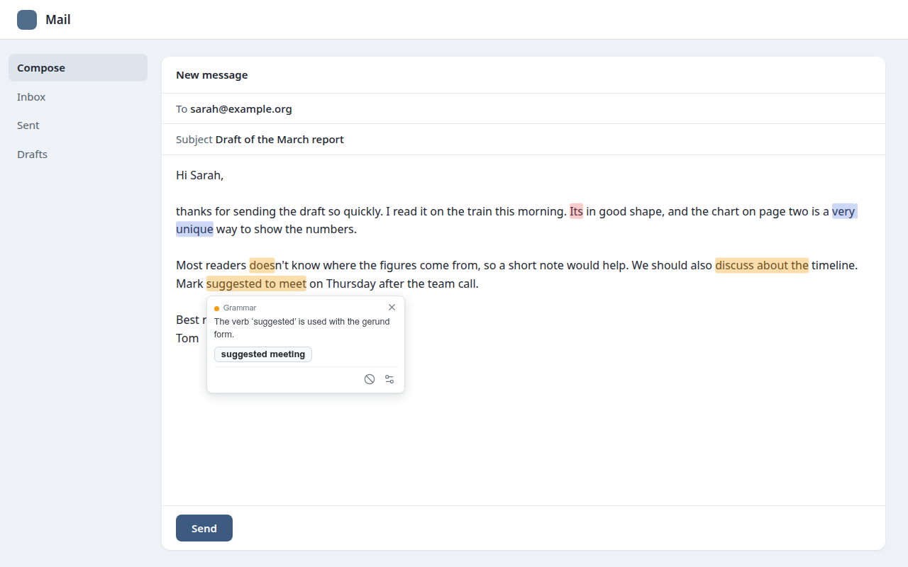
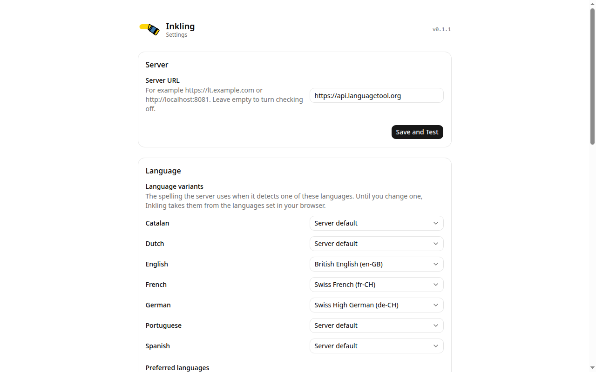

# Inkling

Inkling is a Chrome and Firefox extension that checks spelling and grammar in
your web browser with your own [LanguageTool](https://github.com/languagetool-org/languagetool)
server. Text goes only to the server you configure.

This project is not affiliated with LanguageTooler GmbH or with Automattic.



## Built on Harper

Inkling exists because of [Harper](https://github.com/Automattic/harper), the
open-source grammar checker by Elijah Potter, its contributors and Automattic.
Almost everything you see on a web page is their work: the highlights, the
suggestion popup, the hotkeys, the per-site switch, and the editor support for
plain text fields, Lexical, ProseMirror, Slate, Quill, Draft.js, iframes and
Google Docs. Each of those editors needed its own careful work, and Harper's
team published all of it under Apache-2.0, so others can build on it.

Inkling is a fork of Harper's browser extension at commit `6bb9b661`. It
replaces Harper's built-in checker with requests to a LanguageTool server, which
adds German and the other LanguageTool languages. Everything else from the
Harper repository was removed.

If you write in English, use Harper itself. It runs entirely in your browser,
needs no server, and is fast:
<https://writewithharper.com>.

## Install

- Chrome and other Chromium browsers: [Chrome Web Store](https://chromewebstore.google.com/detail/inkling/lncfkjkgeoepkinifaggpblhpbenemej)
- Firefox: [addons.mozilla.org](https://addons.mozilla.org/firefox/addon/inkling/)

After the install, the settings page opens. Enter the address of your
LanguageTool server and click `Save and Test`.

### Build from source

```sh
make chrome    # packages/extension/package/inkling-chrome.zip
make firefox   # packages/extension/package/inkling-firefox.zip
```

Load the unpacked `packages/extension/build` directory in
`chrome://extensions` (developer mode), or the zip in `about:debugging` in
Firefox.

To ship a build with a server already set:

```sh
LT_DEFAULT_SERVER_URL=https://lt.example.com make chrome
```

## Settings



- `Server URL`: Base URL of the LanguageTool server, for example
  `https://lt.example.com` or `http://localhost:8081`. Empty turns checking off.
  `Save and Test` asks the browser for access to that server. While the field
  is empty, `Use public server` fills in `https://api.languagetool.org`.
- `Language variants`: The variant per language, such as Swiss High German
  (de-CH) or British English (en-GB), that the server uses when it detects
  that language. Until you change one, they follow the languages set in the
  browser. The lists come from the server.
- `Preferred languages`: The languages you write in. They help the server
  detect the language of short texts.
- `Mother tongue`: Lets the server find mistakes typical for speakers of that
  language, such as false friends.
- `Picky mode`: Also reports style issues and less certain mistakes.
- `Enable on new sites`: Off by default. Checking then runs only on the sites
  in the built-in list, on WordPress and Substack sites, and on sites you
  switch on in the popup. When on, checking runs on every site you have not
  switched off in the popup.
- `Delay`: Milliseconds to wait after typing stops before the text is sent to
  the server, from 0 to 60000. Default 500.
- `Activation key`: With `Double Shift` or `Double Control`, pressing that key
  twice opens the suggestion card of the mark nearest the cursor and moves the
  keyboard into it. Default `Off`.
- `Apply-suggestion hotkey`: Applies the first suggestion of the mark nearest
  the cursor, or ignores the mark when it has no suggestion. Default Ctrl+E.
- `User dictionary`: Words that are never marked as spelling mistakes, one per
  line.
- `Export enabled domains`: `Export JSON` downloads a list of the sites that
  are switched on. Sites in the built-in list are only in it when you switched
  them on yourself.
- `Disabled rules`: LanguageTool rule IDs, one per line. "Disable rule" in a
  suggestion adds its rule here.
- `Ignored suggestions`: `Clear` shows all suggestions you ignored again.

## Development

```sh
make check       # TypeScript and Svelte checks
make lint        # Biome
make test-unit   # connector tests, no browser needed
make test        # unit tests plus Playwright tests in Chromium and Firefox
```

The Playwright tests run headed under `xvfb-run` against a stand-in server in
`packages/extension/tests/mockLanguageTool.mjs`. Set `LT_TEST_SERVER` to run
the Chromium test against a real server.

## License

Apache-2.0, see [LICENSE](LICENSE). Copyright for the original code remains with
the Harper authors.
